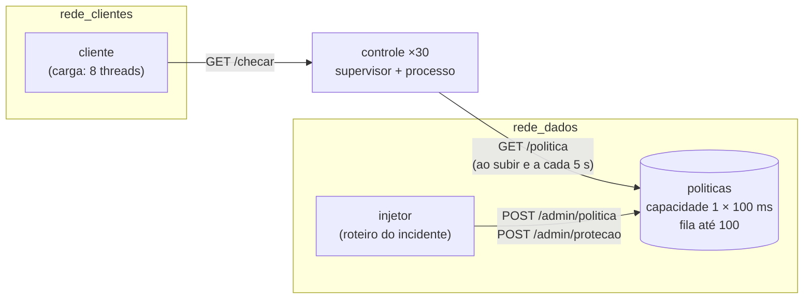

# Miniatura do incidente do Google Cloud (12/06/2025)

Laudo técnico de SRE. Reproduz em Docker Compose o mecanismo do incidente do
Service Control do Google Cloud: uma política com campo em branco derruba todas
as réplicas ao mesmo tempo e, na volta, as réplicas reiniciam e tentam de novo
sem backoff, criando um **efeito manada** que sobrecarrega o banco de políticas
e atrasa a recuperação.

Fonte: <https://status.cloud.google.com/incidents/ow5i3PPK96RduMcb1SsW>

## Requisitos

- Docker com Compose v2 (`docker compose version`)
- Python 3.8 ou mais novo no host (só biblioteca padrão, nada para instalar)
- Cerca de 1 GB de memória livre para os 33 containers

No Windows, rode os comandos no PowerShell ou no Git Bash, com o Docker Desktop aberto.

## Passo a passo

```bash
git clone <este repositório>
cd <pasta do repositório>

# 1) O incidente: reinício e nova tentativa sem backoff (~3 min)
python rodar.py --cenario sem_backoff --rodada 1

# 2) A mitigação: backoff exponencial com jitter (~3 min)
python rodar.py --cenario jitter --rodada 1

# 3) Mitigação alternativa: validar a política antes de aplicar (~3 min)
python rodar.py --cenario validacao --rodada 1
```

Cada comando sobe a miniatura, executa o roteiro do incidente, guarda os logs
em `logs/<cenario>_r<rodada>/`, derruba os containers e gera a análise. Ao
final, `logs/comparacao.md` e `logs/comparacao.svg` comparam todas as execuções.
Para repetir um cenário, use `--rodada 2`, `--rodada 3` etc. Com
`--replicas N`, o número de réplicas do controle muda (padrão 30).

Para analisar de novo sem rodar: `python analisar.py logs/sem_backoff_r1` e
`python analisar.py --comparar`.

## Roteiro de cada execução

Duas referências de tempo: a primeira coluna conta desde a subida dos
containers; a segunda conta desde a política em branco, que é o t = 0 usado
pela análise, pelos `resumo.md` e pelo laudo.

| Desde a subida (s) | Na análise e no laudo (s) | Evento | Quem faz |
|---:|---:|---|---|
| 0 | −30 | Containers sobem; cada réplica do controle espera de 0 a 10 s (implantação gradual) e carrega a política | `controle` |
| 30 | 0 | Política com `limite_por_minuto: null` gravada no banco de políticas | `injetor` |
| 30 a 35 | 0 a 5 | As réplicas recarregam a política (a cada 5 s), quebram no `int(None)` e o supervisor as reinicia | `controle` |
| 50 | 20 | "Botão vermelho": volta uma política válida | `injetor` |
| 110 | 80 | Intervenção manual: o banco de políticas passa a recusar na hora o que passar da capacidade | `injetor` |
| 150 | 120 | Fim | `cliente`, `injetor` |

## Containers e redes



O `controle` está nas duas redes. O `cliente` não enxerga o banco de políticas,
assim como os clientes das APIs do Google não falam com o Spanner.

| Container | O que representa no incidente | Arquivo |
|---|---|---|
| `politicas` | Tabelas regionais do Spanner com as políticas de cota | `miniatura/politicas.py` |
| `controle` (×30) | Tarefas do Service Control que checam cota em cada chamada de API | `miniatura/controle.py` |
| supervisor (dentro de cada `controle`) | O orquestrador que reinicia as tarefas que caem | `miniatura/supervisor.py` |
| `cliente` | Usuários chamando as APIs do Google Cloud | `miniatura/cliente.py` |
| `injetor` | A automação que gravou a política e a equipe que acionou o botão vermelho e depois reduziu a carga | `miniatura/injetor.py` |

## Por que esses parâmetros

O efeito manada só aparece se a demanda das réplicas tentando de novo passa da
capacidade do banco. Escolhemos os valores para que isso aconteça de forma
controlada:

- O banco atende **1 leitura por vez, de 100 ms**: no máximo 10 leituras/s.
- Cada réplica desiste depois de **1 s** (timeout) e, sem backoff, tenta de novo 0,1 s depois.
- Com **30 réplicas**, a demanda na volta chega a cerca de 27 leituras/s, quase 3 vezes a capacidade.
- O banco não sabe que a réplica desistiu: a leitura abandonada continua na
  fila e é processada mesmo assim (trabalho desperdiçado).

Em operação normal, a recarga a cada 5 s gera 6 leituras/s, abaixo da capacidade.

## O que a miniatura não reproduz

| Ponto do sistema real | Na miniatura | Efeito nas conclusões |
|---|---|---|
| Replicação global do Spanner para todas as regiões em segundos | Um único banco, numa única máquina | Não medimos a propagação entre regiões; o "tempo até a falha" mede só o ciclo de recarga (5 s), não a replicação real |
| Milhares de tarefas do Service Control e um Spanner com enorme capacidade | 30 réplicas e um banco de 10 leituras/s, escolhidos para que a demanda na volta (~27/s) passe da capacidade | O colapso é provocado pelos parâmetros: mostra o mecanismo, não prevê se ele ocorreria numa escala real. Os tempos em segundos não se comparam com as horas do incidente |
| Orquestrador do Google reiniciando as tarefas (Borg) | Supervisor em Python dentro de cada container, com reinício em 1 s fixo | O comportamento de reinício foi controlado por nós; o `restart: always` do Docker, que já tem atraso crescente, ficou de fora |
| Recuperação feita por engenheiros (reduzir a criação de tarefas, desviar tráfego) | Um único comando que liga a proteção no banco em t = 80 s (contado desde a política em branco) | O tempo de recuperação sem backoff depende de quando programamos a intervenção; o que vale é ela ter sido necessária, não o número exato |
| Todas as máquinas e redes separadas | Todos os containers dividem os mesmos núcleos do host | Parte da lentidão pode vir da disputa por CPU entre containers, não só da fila do banco |

## Cenários

| Cenário | Reinício após queda | Nova tentativa de carga | Política inválida |
|---|---|---|---|
| `sem_backoff` | 1 s fixo | 0,1 s fixo | derruba o processo |
| `jitter` | aleatório entre 0 e min(10 s, 0,5 s × 2^quedas) | aleatório entre 0 e min(10 s, 0,5 s × 2^tentativa) | derruba o processo |
| `validacao` | 1 s fixo | 0,1 s fixo | é recusada; a réplica mantém a anterior |

## O que fica em `logs/<execucao>/`

As rodadas `_r1` foram feitas em Linux e as `_r2` no Docker Desktop do Windows.
A pasta `logs/invalidas_windows/` guarda três execuções descartadas, em que o
cliente começou depois do incidente (ver `IA.md`, Erro 2). Elas ficam no
repositório como evidência e não entram em `logs/comparacao.md`.

| Arquivo | Conteúdo |
|---|---|
| `eventos.csv` | Marcos do roteiro (referência de tempo da análise) |
| `cliente.csv` | Cada requisição do cliente: alvo, resultado e latência |
| `politicas.csv` | Cada leitura no banco: atendida ou recusada, espera, tempo total e ocupação |
| `politicas_eventos.csv` | Trocas de política e a proteção ligada |
| `controle_<réplica>.csv` | Por réplica: subidas, cargas, falhas, quedas e reinícios |
| `docker_compose.log` | Saída bruta de todos os containers |
| `parametros.json` | Cenário, parâmetros, máquina e versão do Docker |
| `serie_por_segundo.csv` | Linha do tempo segundo a segundo (gerada pela análise) |
| `resumo.md`, `metricas.json` | Métricas, cada uma com o arquivo de log de origem |
| `grafico.svg` | % de erro e réplicas de pé ao longo do tempo |

## Definições das métricas

Todas são calculadas por `analisar.py` a partir dos CSV brutos, com t = 0 no
evento `politica_em_branco`.

- **Erro:** qualquer resposta do cliente diferente de HTTP 200.
- **Tempo até a falha:** primeiro segundo, a partir de t = 0, com 50 % ou mais das requisições com erro.
- **Tempo até a recuperação:** a partir do botão vermelho, primeiro segundo que inicia 5 segundos seguidos com no máximo 5 % de erro.
- **% de requisições com erro:** erros ÷ requisições do cliente, de t = 0 até o fim.
- **Trabalho desperdiçado:** leituras que o banco terminou depois do prazo de 1 s, quando a réplica já tinha desistido.

## Onde o mesmo mecanismo aparece no Origem

Repositório do projeto: <https://github.com/elistenorio/fccpd-concorrencia-fila>

| Arquivo e trecho | Semelhança |
|---|---|
| `app/queue.py`, linha 20: `Retry(max=3, interval=[5, 15, 30])` | Novas tentativas com intervalos crescentes, mas predeterminados e sem jitter: jobs que falham juntos (por exemplo, com o PostgreSQL fora) tentam de novo juntos, exatamente 5, 15 e 30 s depois |
| `app/queue.py`, linha 27, e `app/recomendacoes_cliente.py`, linha 20: `PAUSA_APOS_FALHA_SEGUNDOS = 15` | Pausa fixa de 15 s, sem jitter, no disjuntor. Hoje a `api` roda em um único processo, então o risco ainda é pequeno; se a `api` ganhar réplicas, todas que abriram o disjuntor na mesma falha voltam a tentar no mesmo instante |
| `docker-compose.yml`: `restart: always` e `worker` com `replicas: 3` | Os 3 workers que caem juntos voltam juntos e retomam os jobs contra o mesmo PostgreSQL |
| `app/database.py`, linhas 5 a 7: `create_engine(os.getenv("DATABASE_URL"))` | Configuração usada sem validação, como o campo em branco da política |

## Problemas comuns

- **Linux, permissão negada ao usar `--sobrescrever`:** os containers gravam
  como root. Apague a pasta com `sudo rm -rf logs/<execucao>` ou use outra `--rodada`.
- **A máquina fica lenta ou o Docker não sobe 30 réplicas:** use `--replicas 20`.
  Com 20 réplicas a demanda na volta fica em cerca de 18 leituras/s, quase 2 vezes
  a capacidade do banco. Registre no laudo o número de réplicas usado.

## Uso de IA

Ver [IA.md](IA.md).
